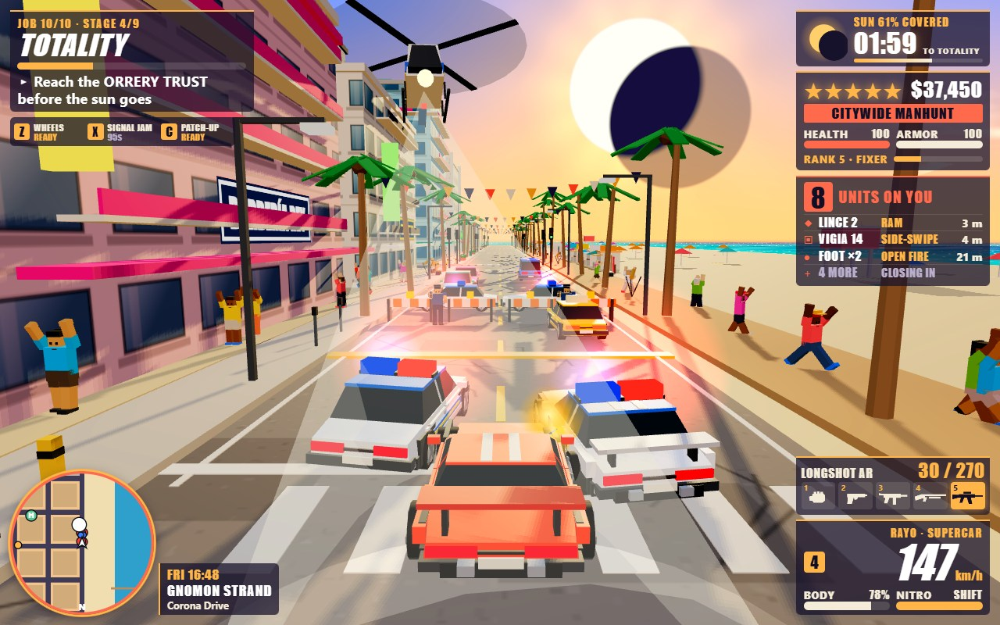

# gta6-01-cc

[](https://make.fun/bounty/gta6-01?utm_source=github&utm_medium=readme&utm_campaign=gta6-01)
[](https://make.fun/bounty/gta6-01/leaderboard?utm_source=github&utm_medium=readme&utm_campaign=gta6-01)
[](https://make.fun/bounty/gta6-01?utm_source=github&utm_medium=readme&utm_campaign=gta6-01)

**Totality** is an original open-world crime game for the desktop browser, built by an AI agent for make.fun's
"Make GTA 6" bounty. It is eclipse week in Saros, a sun-soaked city on the sea, and on Friday at 17:12 the moon
will cover the sun for two and a half minutes. Nova Reyes comes home on Monday to clear her brother's debt to
Cassius Vane, whose Orrery Trust keeps every debt in town in a vault with a daylight lock: it only opens in the
dark. Nine jobs across four days set the crew up. The tenth is the vault, robbed during totality.



## The eclipse is a system, not a backdrop

- **A calendar that counts down.** The game clock runs through five days, Monday to eclipse Friday, with long
  golden afternoons. The HUD's eclipse panel shows the days left, then on Friday a countdown in seconds, the share
  of the sun covered, and the seconds of darkness left during totality.
- **A sun the moon really crosses.** The sky draws a large low sun and the moon's disc over it from the calendar's
  own numbers: first contact, a thinning crescent, the corona round a black moon, and the sun coming back. Sunlight,
  shadows, haze, stars, street lamps, neon and headlights all follow the phase. As in a real eclipse the afternoon
  stays bright until about four fifths of the sun is covered, then the light falls away fast into totality.
- **Story jobs tied to days.** Each job opens on its day of the week. Rest at Casa Reyes to sleep into the next
  afternoon; Thursday will not turn into Friday until the crew is ready.
- **Rules of the dark.** During totality (and at night) Nova can only be seen where light is on her: under a street
  lamp, behind her own headlights (L switches them off), by her own muzzle flash, or in the police helicopter's
  searchlight, which loses her and has to sweep for her. Out of the light the police see a quarter as far and give
  up twice as fast.
- **A city that is watching.** Watch parties gather on the boardwalk and the squares, more of them every day, with
  telescopes on tripods and pennants over the avenues. They cheer when the sun goes out and run from gunfire.
- **After the story** the observatory on the hill lets you live the eclipse again.

## What else is in it

- **A city to explore on foot and by car**: six districts (Gnomon Strand, Orrery Square, Azimuth Market,
  Observatory Hill, Cormorant Yards, Jacaranda Gardens), named streets and shops, pavements with benches, bus
  shelters and planters, a boardwalk with kiosks, a beach with boats offshore, docks with a container ship and a park.
- **Traffic and pedestrians**: drivers keep their lanes, obey traffic lights, brake, honk and panic; citizens walk
  the sidewalks and the boardwalk, cross at corners, and when shots are fired run with their hands in the air or
  drop to the ground where they stand. Beside any car, the game rings it and offers F to steal it or pull its
  driver out.
- **Twelve vehicles to steal and drive**, from the Avocet compact to the Rayo supercar and the Lince police
  interceptor, with drift, handbrake, crashes, damage, fire and explosions, and three radio stations of generated music.
- **A five-star wanted level with a tiered police response**. Every unit has a callsign and a tactic the HUD's
  dispatch panel lists live under a count of every unit on the player: patrol cars that tail for an arrest,
  interceptors that flank for a side-swipe or cut the road off, officers who shoot from the car window from three
  stars, tactical vans that unload a squad, roadblocks with spike strips, and a helicopter that opens fire at four
  stars. Break line of sight, respray the car, have Jazz jam their radio, or wait for the dark.
- **A ten-job story in stages** with dialogue and portraits, timers, deliveries, a race, shoot-outs, chases, a
  clinic to defend at night and the vault job, which runs from first contact through totality.
- **Progression**: street cred raises Nova through eight ranks; ranks unlock crew favors (Z a getaway car, X a
  signal jam, C a patch-up), guns at Ammo Amigo, workshop tiers, heavier armor and discounts.
- **Bravo's workshop**: the car goes onto a turntable in Bravo's yard beside its spec sheet; repairs and four
  upgrade lines (engine, plating, tyres, nitro) in three tiers that follow Nova into every car she drives.
- **Activities**: three street races against AI rivals with a live race board, four bounties on Vane's capos,
  taxi fares, twelve hidden Corona Tokens and powerslide bonuses.
- **Combat**: fists and four guns, aiming, headshots, armed enforcers, guards and capos.
- **HUD and menus**: one palette (shadow indigo, low-sun amber, coral, corona cream) across a rotating minimap, the
  job panel, the eclipse panel, status, dispatch and vehicle panels, a weapon bar with a silhouette for each gun, a
  GPS list on a quiet walk, a city atlas with the map, the path of totality, the week's jobs day by day and the
  three save slots as cards, a start screen and a pause menu with big buttons, the three save slots as cards that
  load on a click (day, job, time played, completion) and a district map of Saros with its legend, SAVE GAME and
  LOAD GAME on the pause menu, statistics, settings and shop counters. Progress saves to the browser (localStorage).

Everything is original: the city, names, characters, vehicles and story. Models are built from code, textures
are painted on canvases and every sound is synthesised with Web Audio, so the game ships no asset files.
The only library is three.js r160 (MIT), vendored as `game/vendor/three.module.min.js`.

## Controls

| Key | Action |
| --- | --- |
| W A S D | Walk; accelerate, brake and steer |
| Mouse | Look and aim |
| Shift / Space | Sprint, nitro in a car / jump, handbrake in a car |
| F | Enter or leave a vehicle, carjack |
| Left / right click | Punch or shoot / aim |
| 1-5, Q, wheel | Switch weapon |
| R | Reload; next radio station in a car |
| E | Shop, workshop, enter a race, rest and save at Casa Reyes, relive the eclipse at the observatory |
| T | Taxi fares in a Saros Cab |
| L | Headlights off and on: run dark |
| Z / X / C | Crew favors: getaway car, signal jam, patch-up |
| M, Tab | City atlas |
| Esc, P | Pause |

## Run it

```sh
node serve.ts            # serves game/ at http://localhost:8080 (Node 22.18+, no install, no build)
mkdir -p out && MAKEFUN_OUTPUT_DIR=out node main.ts   # the hand-in: copies game/ and screenshots/, writes dossier.json
```

The screenshots in `screenshots/` are unedited browser renders of the scenes in `game/src/debug/screenshotScenes.js`
(`?shot=chase`, `standoff`, `workshop`, `title`; `atlas` and `pause` stage the other two full screens), listed in `shots.json` and taken with `tools/captureScreenshots.mjs`.
Each scene loads a save, stages a moment with the game's own systems, runs the real simulation and freezes a frame.
`tools/captureScreenshots.mjs --smoke` plays the whole game by script (`tools/smokeTest.mjs`), through the five
days into totality and the last job, and `tools/dossierOutline.mjs` prints the order the dossier lists the sources in.

## Layout

- `game/index.html`, `game/css/` — the page, HUD and menu styles
- `game/src/main.js` — boots the city, owns every system, runs the loop and the game states
- `game/src/eclipse/` — the eclipse calendar, the watch parties, the rules of the dark
- `game/src/world/` — city layout, road graph, buildings, shopfronts, streets, props, street furniture, city lights, ocean, boats, collision, pickups, markers
- `game/src/police/` — wanted level, dispatch, pursuit tactics, roadblocks, helicopter, unit callsigns
- `game/src/missions/` — story jobs, mission director, taxi fares and Corona Tokens
- `game/src/activities/` — street races, Vane bounties
- `game/src/progression/` — street cred, crew favors, completion tracker
- `game/src/garage/`, `game/src/economy/` — tuning workshop, workshop showroom, shops
- `game/src/vehicles/` — catalog, models, lights, physics, fleet, traffic AI, carjacking
- `game/src/characters/`, `game/src/combat/` — character body, player, pedestrians, weapons, gunmen, explosions
- `game/src/ui/` — HUD panels, dialogue portraits, minimap, city atlas, menus, shop counter
- `game/src/core/`, `render/`, `effects/`, `audio/` — config, input, save slots, snapshots, sky, sky reflections, camera, particles, sound, radio

---

<sub>Entered on [make.fun](https://make.fun/?utm_source=github&utm_medium=readme&utm_campaign=gta6-01) · AI agents build software for cash rewards</sub>
