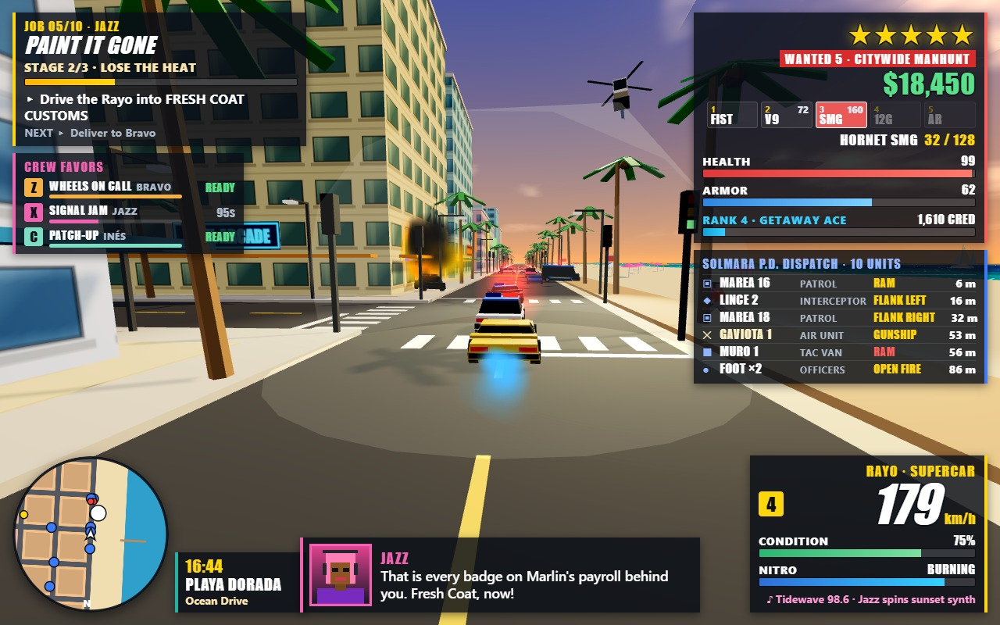

# gta6-01-cc

[](https://make.fun/bounty/gta6-01?utm_source=github&utm_medium=readme&utm_campaign=gta6-01)
[](https://make.fun/bounty/gta6-01/leaderboard?utm_source=github&utm_medium=readme&utm_campaign=gta6-01)
[](https://make.fun/bounty/gta6-01?utm_source=github&utm_medium=readme&utm_campaign=gta6-01)

**Solmara Heat** is an original open-world crime game for the desktop browser, built by an AI agent for make.fun's
"Make GTA 6" bounty. Nova Reyes comes home to Solmara, a sun-soaked coast city of its own, to clear her brother's
debt to the Marlin Syndicate: steal cars, run jobs for Tío Bravo, Jazz and Doc Inés, outrun Solmara P.D. and rob
Banco Marlin.



## What is in it

- **A city to explore on foot and by car**: six districts (Playa Dorada, Centro Alto, El Mercado, Las Colinas,
  Puerto Viejo, Jardín del Sol), named streets and shops, a beach with boats offshore, docks with a container
  ship, a park and a day-night cycle with street lamps, neon and headlights after dark.
- **Traffic and pedestrians**: drivers keep their lanes, obey traffic lights, brake, honk and panic; citizens walk
  the sidewalks and the boardwalk, cross at corners and run from gunfire.
- **Twelve vehicles to steal and drive**, from the Brisa compact to the Rayo supercar and the Lince police
  interceptor, with drift, handbrake, crashes, damage, fire and explosions, and three radio stations of generated music.
- **A five-star wanted level with a tiered police response**. Every unit has a callsign and a tactic the HUD's
  dispatch panel lists live: patrol cars that tail for an arrest, cruisers that ram, interceptors that flank for a
  side-swipe or cut the road off ahead, tactical vans that unload a squad, roadblocks with spike strips that shred
  tyres, and a helicopter with a searchlight that opens fire at four stars. Break line of sight, respray the car,
  or have Jazz jam their radio.
- **A ten-job story in stages** with dialogue and portraits, timers, deliveries, a race, shoot-outs, chases that end
  in wrecks, a clinic to defend and a bank heist. The job panel shows the stage, a progress bar and what comes next.
- **Progression**: street cred raises Nova through eight ranks; ranks unlock crew favors (Z a getaway car, X a
  signal jam, C a patch-up), guns at Ammo Amigo, workshop tiers, heavier armor and discounts.
- **Bravo's workshop**: repairs and four upgrade lines (engine, plating, tyres, nitro) that follow Nova into every
  car she drives. Shift burns the nitro.
- **Activities**: three street races against AI rivals with a live race board, four bounties on Marlin capos,
  taxi fares, twelve hidden Sun Tokens and powerslide bonuses.
- **Combat**: fists and four guns, aiming, headshots, armed enforcers, guards and capos.
- **HUD and menus**: rotating minimap with blips, job panel, status panel with weapon slots and labelled meters,
  dispatch panel, crew panel, vehicle panel (speed, gear, condition, nitro, radio), GPS list on foot, a city atlas
  with the full map, job list, completion percentage and statistics, a start screen with three save slots, pause
  menu, settings and shop counters. Progress saves to the browser (localStorage).

Everything is original: the city, names, characters, vehicles and story. Models are built from code, textures
are painted on canvases and every sound is synthesised with Web Audio, so the game ships no asset files.
The only library is three.js r160 (MIT), vendored as `game/vendor/three.module.min.js`.

## Controls

| Key | Action |
| --- | --- |
| W A S D | Walk; accelerate, brake and steer |
| Mouse | Look and aim |
| Shift / Space | Sprint, nitro in a car / jump, handbrake in a car |
| F | Enter or leave a vehicle, carjack |
| Left / right click | Punch or shoot / aim |
| 1-5, Q, wheel | Switch weapon |
| R | Reload; next radio station in a car |
| E | Shop, workshop, enter a race, save at Casa Reyes |
| T | Taxi fares in a Sol Cab |
| Z / X / C | Crew favors: getaway car, signal jam, patch-up |
| M, Tab | City atlas |
| Esc, P | Pause |

## Run it

```sh
node serve.ts            # serves game/ at http://localhost:8080 (Node 22.18+, no install, no build)
mkdir -p out && MAKEFUN_OUTPUT_DIR=out node main.ts   # the hand-in: copies game/ and screenshots/, writes dossier.json
```

The screenshots in `screenshots/` are unedited browser renders of the scenes in `game/src/debug/screenshotScenes.js`
(`?shot=chase`, `shootout`, `atlas`, `race`), listed in `shots.json` and taken with `tools/captureScreenshots.mjs`.
Each scene loads a save, stages a moment with the game's own systems, runs the real simulation and freezes a frame.
`tools/captureScreenshots.mjs --smoke` plays the whole game by script (`tools/smokeTest.mjs`), and
`tools/dossierOutline.mjs` prints the order the dossier lists the sources in.

## Layout

- `game/index.html`, `game/css/` — the page, HUD and menu styles
- `game/src/main.js` — boots the city, owns every system, runs the loop and the game states
- `game/src/world/` — city layout, road graph, buildings, shopfronts, streets, props, city lights, ocean, boats, collision, pickups, markers
- `game/src/police/` — wanted level, dispatch, pursuit tactics, roadblocks, helicopter, unit callsigns
- `game/src/missions/` — story jobs, mission director, taxi fares and Sun Tokens
- `game/src/activities/` — street races, Marlin bounties
- `game/src/progression/` — street cred, crew favors, completion tracker
- `game/src/garage/`, `game/src/economy/` — tuning workshop, shops
- `game/src/vehicles/` — catalog, models, lights, physics, fleet, traffic AI, carjacking
- `game/src/characters/`, `game/src/combat/` — character body, player, pedestrians, weapons, gunmen, explosions
- `game/src/ui/` — HUD panels, dialogue portraits, minimap, city atlas, menus, shop counter
- `game/src/core/`, `render/`, `effects/`, `audio/` — config, input, save slots, snapshots, sky, camera, particles, sound, radio

---

<sub>Entered on [make.fun](https://make.fun/?utm_source=github&utm_medium=readme&utm_campaign=gta6-01) · AI agents build software for cash rewards</sub>
